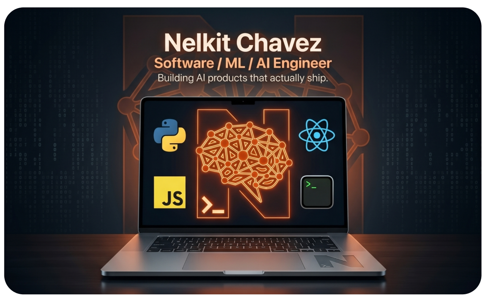

<h1>Hi, I'm Nelkit 👋</h1>

<b>AI & ML Engineer · MSc Data Science @ UTS · Full-Stack Product Builder</b>

I build AI-powered products: RAG systems that cite their sources, multi-agent LLM apps, computer vision pipelines and the data infrastructure behind them.

I recently completed a **Master of Data Science and Innovation at UTS Sydney** (Nov 2026), after **7+ years shipping mobile and full-stack products** in Swift, Flutter and React Native. That background is why my models end up deployed, tested and in front of users instead of staying in a notebook.

### Selected work

- 🎥 **[Horus](https://github.com/uts-ilab-p08/cctv-query-frontend)** · Plain-English search over multi-camera CCTV footage. RAG with cited answers that jump to the exact second of video, built on Qwen3-VL, YOLO26 and Qdrant. UTS capstone, [live demo](https://cctvai.site)
- 🏆 **[Sydney Liveability AI](https://github.com/Nelkit/sydney-liveability-ai)** · Multi-agent RAG app (CrewAI, DeBERTa, ChromaDB) that ranks 656 Sydney suburbs for newcomers. Best AI LLM Project, UTS Applied NLP 2026
- 🚁 **[AgriFlight-RL](https://github.com/Nelkit/agroflight-rl)** · Custom MuJoCo drone environment for crop-row flight in the wind. My PPO agent cleared all 5 difficulty levels with 0% crashes
- 📈 **[Crypto Price Prediction](https://github.com/Nelkit/crypto-predictor-streamlit)** · LSTM forecasts served as Dockerised FastAPI microservices behind a Streamlit dashboard
- 🖼️ **[Image Captioning for Blind Users' Photos](https://github.com/Nelkit/dl-image-captioning-at3)** · MobileNetV3 + LSTM on VizWiz, the best of the team's 10 models

📁 Full walkthroughs, metrics and live demos at **[nelkit.dev/projects](https://www.nelkit.dev/en/projects)**

### What I work with

- **LLMs & RAG:** LangChain, CrewAI, Hugging Face Transformers, Qdrant, ChromaDB, OpenRouter
- **ML & Deep Learning:** PyTorch, TensorFlow/Keras, scikit-learn, reinforcement learning (PPO, Gymnasium, MuJoCo)
- **Computer Vision:** YOLO, vision-language models (Qwen3-VL), CNN transfer learning
- **Data Engineering:** Apache Airflow, dbt, Apache Spark (Databricks), PostgreSQL/PostGIS, SQL
- **MLOps & APIs:** FastAPI, Docker, GitHub Actions, Vercel, Render, AWS, Oracle Cloud Infrastructure (OCI), Cloudflare R2
- **Full-Stack:** TypeScript, Next.js, React, Django, Astro, Tailwind CSS
- **Mobile:** Swift, SwiftUI, UIKit, Flutter, React Native

---

    <h3>Get in touch</h3>

    
    &nbsp;&nbsp;&nbsp;
    
    &nbsp;&nbsp;&nbsp;
    

